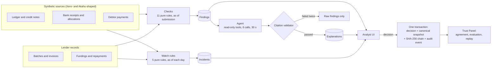

# Credit Desk

A prototype credit operations desk for invoice finance. Deterministic checks
flag risky invoices before funding, watch rules track the funded book, an LLM
agent explains each flag and has to cite the records behind every claim, a
validator rejects anything it cannot ground, and an analyst makes every
decision. A Trust Panel measures how often the agent agrees with analysts who
decided without seeing it, and replays any decision exactly as it was made.

> Prototype for discussion. All data is synthetic.

**Rules detect, the model explains, a validator checks the model, and a person
decides.** The agent never approves, funds or changes anything.

## Contents

- [What it does](#what-it-does)
- [Architecture](#architecture)
- [Run it locally](#run-it-locally)
- [Evaluation](#evaluation)
- [Limitations](#limitations)
- [What production would need](#what-production-would-need)
- [Project docs](#project-docs)

## What it does

| Part | What an analyst sees |
| --- | --- |
| Overview | Funds in use against each facility, batches waiting for review |
| Invoice Check | Batch summary (face value, flagged value, fundable amount on a double rule), debtor concentration, an invoice table, and an invoice panel with the checks that fired, the agent's explanation with numbered evidence, and Approve, Hold or Reject |
| Portfolio Watch | A date stepper over 90 days of history; incidents appear as debtors slow down, credit notes hit funded invoices, invoices go overdue, or concentration rises; Acknowledge or Resolve with a note |
| Trust Panel | Agreement (shadow mode only, with kappa, confidence intervals, a confusion matrix and disagreements), Evaluation (precision and recall per check and rule, agent metrics) and Replay (render a decision from its frozen, checksummed snapshot) |
| Audit log | Every decision and incident action, newest first, append-only |

## Architecture



| Layer | Where | Notes |
| --- | --- | --- |
| Checks | `lib/checks/` | Pure functions, thresholds in `config.ts` with `CONFIG_VERSION`; context built as of the submission date (ADR 0006) |
| Watch | `lib/watch/` | Pure functions over the book as of a date; idempotent runner with incident lifecycle |
| Agent | `lib/agent/` | OpenAI-compatible client (Groq by default), scoped tools, `submit_explanation` tool, citation validator, versioned prompts (ADR 0002, 0003) |
| Trust | `lib/trust/` | Shadow-mode eligibility, kappa and Wilson intervals, canonical-JSON snapshots with a hash chain (ADR 0004, 0005) |
| Data | `lib/db/`, `lib/seed/` | Drizzle schema with append-only triggers; deterministic 90-day generator with reference labels |
| App | `app/`, `components/` | Next.js 16 App Router, Tailwind, shadcn/ui; password gate in `proxy.ts` |

## Run it locally

Requirements: Node 24 (see `.nvmrc`). No database server is needed locally:
with `DATABASE_URL` empty the app uses PGlite, an in-process Postgres, stored in
`.pglite/`.

```bash
npm ci
cp .env.example .env.local          # then fill in the values below
npm run seed -- --target=local      # data, checks and 90 days of watch runs
npm run precompute                  # agent explanations (needs LLM_API_KEY; about a minute per invoice on the free tier)
npm run simulate                    # simulated past decisions for the agreement history
npm run dev
```

| Variable | Needed for |
| --- | --- |
| `LLM_PROVIDER`, `LLM_BASE_URL`, `LLM_API_KEY`, `LLM_MODEL` | Precompute and the Re-run agent button |
| `DEMO_PASSWORD`, `SESSION_SECRET` (32+ characters) | The password gate; without them the gate is off in development and the app refuses to serve in production |
| `DATABASE_URL` | Neon in production; leave empty locally |
| `CRON_SECRET` | Optional daily watch run at `/api/watch/run` |

Quality checks (all run in CI):

```bash
npm run typecheck && npm run lint && npm run format:check && npm test && npm run build && npm run check:bundle && npm run eval
```

## Evaluation

`npm run eval` builds two synthetic datasets in memory, a development seed and
a holdout seed with different parameters, runs every check and watch rule, and
scores them against labels. It writes `eval/report.json`, which the Evaluation
tab renders. CI fails if any check's precision or recall on the holdout seed
drops below its configured minimum.

| | Development | Holdout |
| --- | --- | --- |
| Invoices (labelled with a problem) | 251 (38) | 237 (42) |
| Checks: precision and recall, all eleven | 1.00 and 1.00 | 1.00 and 1.00 |
| Watch rules: precision and recall, four with positives | 1.00 and 1.00 | 1.00 and 1.00 |

Agent metrics come from the stored precompute runs (CI never calls the model)
and are shown on the Evaluation tab: validator pass rate, schema pass rate,
citation validity, amount and date faithfulness, retry rate, tokens and time.

How to read these numbers: labels and checks both encode the specification, so
perfect scores show the code implements the rules as written. They do not show
the rules catch real fraud. The validator proves that citations exist and that
figures match the cited records; it does not prove the reasoning is right.

## Limitations

- All data is synthetic. There is no connection to Xero, Akahu or any real
  system.
- Thresholds are the specification's defaults, not calibrated on real losses.
- Simulated analyst decisions are derived from the evaluation labels. They
  exist to show the agreement view and are kept in a separate cohort.
- Sign-in is a shared password with a self-declared name, so attribution in
  the audit log is not authenticated.
- Snapshot checksums detect accidental or casual changes. They do not stop
  someone with full database access.
- The LLM runs on Groq's free tier, which is acceptable only because the data
  is synthetic.

## What production would need

- Real authentication with roles and maker-checker approval.
- Xero and Akahu integrations under the relevant accreditation.
- Immutable audit storage with snapshot hashes anchored outside the database.
- Data retention and access under the Privacy Act 2020, and AML/CFT
  considerations.
- Threshold calibration on real loss data, with monitoring and alerting.
- A provider and data-residency review before any real customer data reaches a
  model.

## Project docs

- [SPEC.md](SPEC.md): product and technical specification
- [docs/reviews](docs/reviews): design review and how each finding was resolved
- [docs/adr](docs/adr): architecture decision records
- [CONTRIBUTING.md](CONTRIBUTING.md) and [SECURITY.md](SECURITY.md)
